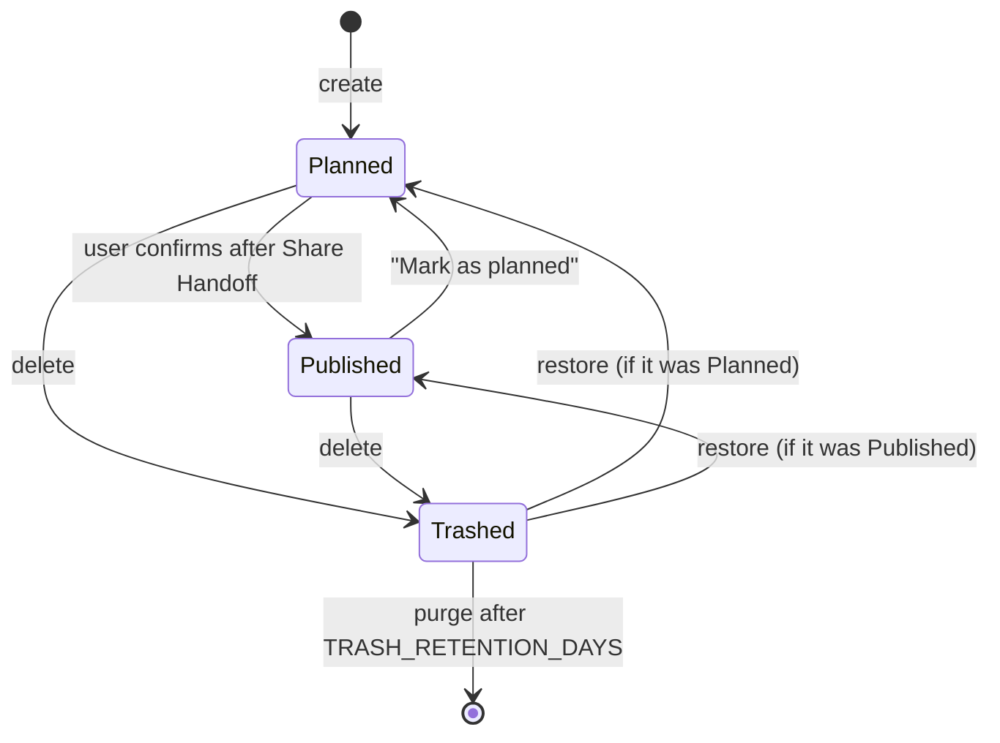

# Griddy — Model Document

What Griddy is, what it must do and why. How it is built lives in the [SDD](sdd.md).

- **Version:** 0.1
- **Date:** 2026-10-23
- **Status:** Draft
- **Authors:** Valentín Rodrigo Osa Pochelú

## How to read this document

| If you want to… | Read |
|---|---|
| Understand Griddy in five minutes | Section 0 |
| Know the exact behavior rules | Section 6 and the [Phase 1 spec](poc-spec.md) |
| Know why something was decided | Section 9 and the [ADRs](adr/README.md) |
| Know what is still open | Section 10 |

**Conventions**

- Domain terms (Post, Slide, Carousel…) are defined in the [glossary](../CONTEXT.md) and always used with that meaning.
- Identifiers defined here: `S-xx` assumptions, `R-xx` rules, `P-xx` pending items. Features (`F-xx`) are defined in the phase specs. Decisions are ADRs (`ADR-NNNN`).
- Numbers are never written in rules: rules use parameter names from section 7, where each value is fixed once with its origin.

## 0. Summary

- **What:** a mobile-first planner for an Instagram profile grid.
- **For whom:** first the owner, who plans and publishes from an Android phone; later creators who curate their grid.
- **Problem:** existing planners are paid, clumsy with Carousels, or preview the grid inaccurately; after planning, users must hunt for the photos again to publish.
- **Core loop:** add photos as Posts and Carousels, arrange the Grid, frame each Slide, preview exactly what Instagram will show, then hand the Post to Instagram at full quality.
- **Approach:** a local-first web app (ADR-0008), installable as a PWA (ADR-0011), later wrapped as an Android APK and connected to the official Instagram API.
- **Success:** the owner plans and publishes their real grid with Griddy, with no lost work and a preview that matches Instagram.

## 1. Context and objectives

### 1.1 Problem

Planning a cohesive Instagram grid means deciding order, shape and framing of many photos before publishing. Instagram only shows the result after publishing. Available planners tested by the owner fail on at least one of: price, fast Carousel editing, accurate preview of the current portrait grid, or publishing without searching the gallery again.

### 1.2 Objectives

Each objective is verifiable:

1. Plan a Grid of photo Posts and Carousels entirely on an Android phone.
2. The preview matches Instagram's profile grid (S-01) and Post shapes (S-02).
3. Hand a Post to Instagram at Export Quality without opening the gallery (ADR-0003).
4. No planning work is lost by mistake: every destructive action is recoverable (ADR-0010).
5. Portfolio quality: every decision documented, automated tests and CI on every change.

### 1.3 Why this approach

A web app runs on the owner's phone today with no store, and the same code becomes an APK later (ADR-0002). Local-first avoids server cost and keeps photos private until a backend is justified (ADR-0008).

### 1.4 Scope

Phases and their content are in [ROADMAP.md](../ROADMAP.md). The current phase is specified in the [Phase 1 spec](poc-spec.md), including what is out of scope.

## 2. System description

### 2.1 Main flow

1. The user taps "New post" and selects one or more photos; Griddy creates a Post at the top of the Grid (R-05).
2. In the Post editor the user reorders, adds, removes or replaces Slides, picks the Aspect Ratio and reframes each Slide (R-02, R-03).
3. In the Grid the user drags Posts until the layout looks right.
4. When it is time to publish, Griddy marks the Next Post (R-06). The user shares it; Griddy renders the Slides at Export Quality (R-12) and opens the share sheet.
5. Back in Griddy, the user confirms the Post was published (R-07).

### 2.2 Post lifecycle

Deleting a Post in Griddy never deletes anything on Instagram.

### 2.3 Example

The owner plans 6 Posts. The Grid shows them in two rows, newest at top-left. The bottom-right Post is the Next Post. They share it, publish it in Instagram and confirm; it becomes Published and the Post to its left becomes the Next Post. Later they switch a Carousel from 4:5 to 1:1, dislike it and switch back: every Slide recovers its 4:5 framing (R-03).

## 3. Assumptions

| ID | Assumption | Why | Effect if wrong |
|---|---|---|---|
| S-01 | Instagram's mobile profile grid shows each Post as a center-cropped thumbnail at `GRID_THUMBNAIL_RATIO`. | Platform behavior reported as of June 2026; desktop web still shows squares. | The Grid preview misleads; mitigated because the ratio is a parameter. |
| S-02 | Instagram app Posts accept up to `MAX_SLIDES` Slides and the ratios 1:1, 4:5 and 3:4, and crop every Slide to the first Slide's ratio. The publishing API accepts at most 10 Slides and ratios from 4:5 to 1.91:1. | Platform documentation and guides, October 2026. | Posts valid for Share Handoff may be rejected by the API; must be re-verified before the API phase. |
| S-03 | The official API requires a professional (Creator or Business) account, a registered Meta app and media at a public URL. The owner's account is public and can switch to Creator. | Meta platform requirements. | The API phase is blocked or needs another approach. |
| S-04 | Browser site data persists long term once persistent storage is granted, but is lost if the user clears site data or uninstalls the browser. | Browser storage behavior. | Data loss; mitigated by backups (F-10). |
| S-05 | Instagram displays photos at most `EXPORT_WIDTH_PX` wide; larger uploads gain no visible quality. | Platform guidance. | Exports could be sharper; only `EXPORT_WIDTH_PX` changes. |
| S-06 | The owner has no published posts today. | Stated by the owner. | Justifies postponing import of Published Posts (ADR-0007). |

## 4. External dependencies

| Dependency | Used for | Status |
|---|---|---|
| Instagram app (Android) | Receives Shared Slides and publishes | Behavior with multiple shared images pending (P-01) |
| Browser storage (IndexedDB, persistent storage) | All local data | S-04 |
| Web Share API with files | Share Handoff | Supported on Chrome for Android; desktop falls back to downloads |
| Instagram API (later phase) | Sync and direct publishing | S-02, S-03 |

## 5. Domain elements

Terms are defined in the [glossary](../CONTEXT.md). Main entities and their product-level attributes:

| Entity | Attributes |
|---|---|
| Profile | name; owns the Grid (ADR-0004) |
| Post | Slides in order, Aspect Ratio, state (Planned, Published, Trashed), position in the Grid |
| Slide | media type (photo only in Phase 1, ADR-0001), reference to a Photo, one Crop per Aspect Ratio |
| Photo | original file, never modified |
| Crop | position, zoom and rotation inside an Aspect Ratio |
| Snapshot | the state of a Post at a moment, with a short label |
| Theme | named set of color tokens, light and dark variants (ADR-0013) |

## 6. Rules

| ID | Rule | Origin |
|---|---|---|
| R-01 | A Post has between 1 and `MAX_SLIDES` Slides. | S-02 |
| R-02 | Every Slide of a Post uses the Post's Aspect Ratio: 1:1, 4:5 or 3:4. A new Post uses `DEFAULT_ASPECT_RATIO`. | ADR-0006 |
| R-03 | Photos are never modified. Each Slide stores one Crop per Aspect Ratio (position, zoom, rotation); a new Crop is centered. The photo always covers the whole frame. | ADR-0006 |
| R-04 | The Cover of a Post is its first Slide. | Instagram behavior |
| R-05 | The Grid shows the newest Post at top-left. Planned Posts are always above Published Posts; Published Posts cannot be moved. A new Post is placed at the top (pending confirmation, P-03). | ADR-0007 |
| R-06 | The Next Post is the Planned Post closest to the Published Posts, that is, the last Planned Post in Grid order. With no Planned Posts there is no Next Post. | Instagram places new posts at top-left |
| R-07 | A Planned Post becomes Published only when the user confirms it after a Share Handoff. The user can return a Published Post to Planned. | ADR-0007 |
| R-08 | Removing the last Slide of a Post moves the Post to the Trash. | R-01 |
| R-09 | Deleting a Post moves it to the Trash, offering Undo for `UNDO_WINDOW_SECONDS`. A Trashed Post can be restored to its previous state for `TRASH_RETENTION_DAYS`, then it is purged. | ADR-0010 |
| R-10 | Every change to a Post records a Snapshot. Restoring a Snapshot records a new Snapshot. Snapshots are kept for `HISTORY_RETENTION_DAYS` or the last `HISTORY_MIN_SNAPSHOTS` per Post, whichever keeps more. | ADR-0010 |
| R-11 | A Photo is deleted only when no Post, Trashed Post or Snapshot references it. | ADR-0010 |
| R-12 | Export Quality renders each Slide from Photo and Crop at `EXPORT_WIDTH_PX` wide and the height given by the Aspect Ratio, in Slide order. | S-05 |
| R-13 | The Grid Thumbnail of a Post is a center crop of its Cover at `GRID_THUMBNAIL_RATIO`. | S-01 |

## 7. Parameters

Each value is fixed here once. Code reads them from configuration (see SDD section 3); docs refer to them by name.

| Name | Value | Origin |
|---|---|---|
| `MAX_SLIDES` | 20 | S-02 |
| `DEFAULT_ASPECT_RATIO` | 4:5 | ADR-0006; the tallest ratio also accepted by the API (S-02) |
| `GRID_THUMBNAIL_RATIO` | 3:4 | S-01 |
| `EXPORT_WIDTH_PX` | 1080 | S-05 |
| `UNDO_WINDOW_SECONDS` | 5 | ADR-0010; long enough to react, short enough not to block |
| `TRASH_RETENTION_DAYS` | 30 | ADR-0010; owner's choice |
| `HISTORY_RETENTION_DAYS` | 30 | ADR-0010; aligned with the Trash |
| `HISTORY_MIN_SNAPSHOTS` | 50 | ADR-0010 |

Derived values, for illustration only: with `EXPORT_WIDTH_PX` = 1080, exports are 1080×1080 (1:1), 1080×1350 (4:5) and 1080×1440 (3:4), computed as width × ratio.

## 8. Acceptance

Each phase spec defines acceptance criteria per feature. A phase is done when all its features meet them and CI passes.

## 9. Decision register

Decisions are recorded as ADRs in [docs/adr](adr/README.md), which holds the index with type and status. This document cites them and never restates their reasoning.

## 10. Pending items and limitations

### 10.1 Pending

| ID | Pending | Affects |
|---|---|---|
| P-01 | Verify on the owner's phone that Instagram accepts several images from the web share sheet as one Carousel and keeps their order. Fallbacks: share one by one in order, or numbered downloads. | F-06, ADR-0003 |
| P-02 | Choose the distribution model: open-source self-hosted, paid hosted product, or open core. | ADR-0008, API phase |
| P-03 | Confirm where a new Post is placed: top of the Grid (current) or next to the Next Post. | R-05, F-02 |
| P-04 | Owner review of the testing strategy once the project skeleton exists. | SDD section 9 |
| P-05 | Check persistent-storage behavior on the owner's phone and browser. | S-04, F-09 |

### 10.2 Limitations

- Posts published outside Griddy are invisible until the API phase (ADR-0007); the plan can drift from the real Profile if the user publishes elsewhere.
- The preview cannot reproduce Instagram's own compression after upload; it shows Export Quality.

## 11. Changes

| Version | Date | Change | Reason |
|---|---|---|---|
| 0.1 | 2026-10-23 | First version: summary, objectives, flow, assumptions, rules, parameters and pending items, consolidated from the planning session | Set up SDD documentation |
